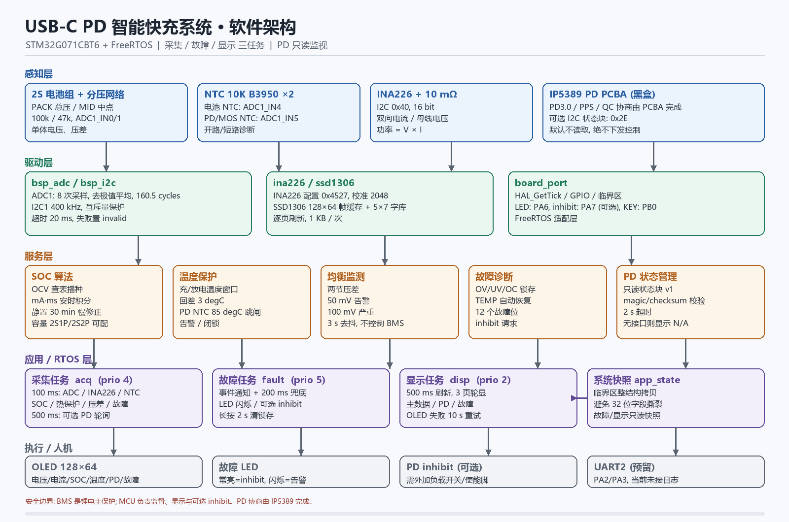

# USB-C PD 智能快充系统

> **2S 18650 锂电池组 + 30 W USB-C PD 双向快充 + STM32G071CBT6 主控**  
> 采购、软件、接线与测试的完整工程资料。



---

## 1. 项目组成

| 部分 | 文档/代码 | 说明 |
|------|-----------|------|
| 硬件采购 | [采购清单](采购清单.md) · [参考 BOM](参考-BOM预算.png) | IP5389 2S/30 W、STM32G071、INA226、OLED、BMS、电芯 |
| 软件设计 | [软件设计说明](软件设计说明.md) | 9 个软件模块、任务、算法、故障状态机 |
| 软件代码 | [software/](software/) | 可编译的 C 工程、STM32G0 适配、221 项主机测试 |
| 面包板接线 | [面包板接线图](面包板接线图.md) · [PNG](docs/面包板接线图.png) | 网络标号、功率路径、上电顺序 |
| 接线与集成 | [软件集成与接线](软件集成与接线.md) | 引脚、CubeMX、校准、上电顺序、可选 inhibit |
| 测试 | [测试报告](测试报告.md) | 主机测试结果、场景数据、HIL 清单 |

---

## 2. 软件状态

| 项目 | 状态 |
|------|------|
| 应用层/算法 | ✅ 完成，主机测试 221 项通过 |
| STM32G0 适配层 | ✅ 提供，需配合 CubeMX HAL/FreeRTOS 工程编译 |
| FreeRTOS 三任务 | ✅ 提供，语法检查通过；HIL 时序待测 |
| 目标板 HIL | ⏳ 未执行，按 [测试报告](测试报告.md) 第 5 节进行 |
| PD 控制 | ⚠️ IP5389 黑盒，默认只读；不自定义 PDO/PPS |

```
checks: 221, failures: 0
RESULT: PASS
```

---

## 3. 快速开始（软件）

```bash
cd software
make test             # 221 项主机测试
make syntax           # FreeRTOS 应用层语法检查
make syntax-platform  # STM32G0 HAL 适配层语法检查
```

目标板：用 STM32CubeMX 建立 STM32G071CBT6 工程，添加 `software/src`、
`software/platform/stm32g0` 与头文件路径，在 `MX_*_Init()` 后调用 `app_main()`。
详细步骤见 [软件集成与接线](软件集成与接线.md)。

---

## 4. 硬件拓扑

```
[2S 电芯] ──F1── [2S BMS] ──┬── [INA226 10mΩ] ── [IP5389 PD 模块] ── USB-C
                            └──────────────────── [PD 模块 BAT-]

[BMS P+/P-] ── 100k/47k ── PA0/PA1 (PACK/MID)
[电池 NTC] ── 10k 上拉 ── PA4
[PD/MOS NTC] ── 10k 上拉 ── PA5
[OLED/INA226] ── PB6/PB7 I2C1 400kHz
```

- INA226 的 0.1 Ω 板载电阻必须换成 **10 mΩ**。
- 5 V 从 PD 模块 BAT+ 经 MP1584 降压，不要从 USB-C VBUS 取。
- BMS 是电芯主保护；MCU 只做监督、显示与可选 inhibit。

---

## 5. 9 个软件模块

| 图片需求 | 实现 |
|----------|------|
| ADC 驱动 | `bsp_adc_stm32g0.c` + `battery_math.c` |
| I2C 驱动 | `bsp_i2c_stm32g0.c` |
| 电流检测 | `ina226.c` |
| SOC 算法 | `soc.c`（OCV 查表 + 安时积分） |
| 温度保护 | `ntc.c` + `thermal.c` |
| 电池均衡监测 | `balance.c` |
| 故障诊断 | `fault_diag.c` |
| RTOS | `app_tasks.c` + `FreeRTOSConfig.h` |
| PD 状态管理 | `pd_status.c`（默认 N/A，可选只读后端） |

---

## 6. 安全声明

本项目是**自制样机**，不是经过认证的商品。锂电操作有起火/爆炸风险：

- 首次上电用限流稳压电源模拟电池，不要直接上满电电芯。
- 电芯必须同批次、同内阻、同容量配组；2S2P 两两并联后再串联。
- 8.4 V 充电截止、10 A 慢断保险丝、BMS、阻燃外壳、防反接一个都不能省。
- 固件不替代 BMS；PD 模块黑盒，不要盲目写未知寄存器。
- 商品化需考虑 USB PD 认证、UN38.3、CE/FCC 等合规要求。


