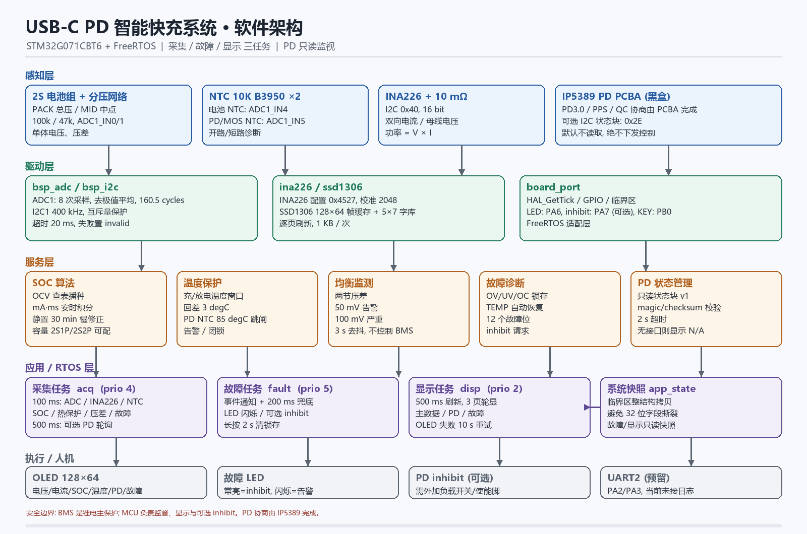

# USB-C PD 智能快充系统 · 软件设计说明

> **版本**：v1.0.0  
> **日期**：2026-11-21  
> **硬件平台**：STM32G071CBT6（Cortex-M0+ @64 MHz，128 KB Flash / 36 KB RAM）  
> **软件平台**：FreeRTOS 10.x + STM32G0 HAL  
> **配套**：[采购清单](采购清单.md) · [面包板接线图](面包板接线图.md) · [软件集成与接线](软件集成与接线.md) · [测试报告](测试报告.md) · [软件工程](software/README.md)



---

## 1. 范围与目标

图片给出的软件需求是 9 个模块：ADC 驱动、I2C 驱动、电流检测、SOC 算法、
温度保护、电池均衡监测、故障诊断、RTOS、PD 状态管理。本设计把这 9 项落到
一个可编译、可测试的 C 工程中，并明确三项边界：

1. **PD 协商由 IP5389 PCBA 完成**。STM32 只读状态，不写 PDO/PPS，也不改充电电流。
2. **BMS 是电芯主保护**。MCU 做监督、告警、显示，以及可选的 load-enable 请求。
3. **没有硬件使能脚时，故障只告警**。`APP_LOAD_INHIBIT_ENABLED=0` 是默认值，
   因为采购清单中的 IP5389 模块与 2S BMS 并未预留 MCU 控制的使能引脚。

目标工况：2S1P 2500 mAh、30 W 双向（放电约 4.1 A，充电约 3.6 A），
2S2P 时把 `APP_BATTERY_PARALLEL` 改为 2。

---

## 2. 需求追踪矩阵

| # | 图片中的软件模块 | 具体功能 | 实现文件 | 关键设计 | 测试 |
|---|------------------|----------|----------|----------|------|
| 1 | ADC 驱动 | 电池组总电压和单节电压采集 | `platform/stm32g0/bsp_adc_stm32g0.c`、`src/services/battery_math.c` | ADC1 四通道、160.5 cycles、8 次去极值平均、100 k/47 k 分压还原 | `test_battery.c` |
| 2 | I2C 驱动 | INA226、OLED 通信 | `platform/stm32g0/bsp_i2c_stm32g0.c` | I2C1 400 kHz、7 位地址、20 ms 超时、任务互斥、失败可见 | 主机 mock + HIL 清单 |
| 3 | 电流检测 | 充放电电流及功率计算 | `src/drivers/ina226.c` | 0x4527 配置、10 mΩ、LSB 250 µA、校准 2048、双向符号 | `test_ina226.c` |
| 4 | SOC 算法 | 电压查表 + 安时积分 | `src/services/soc.c` | 单节 OCV 表、mA·ms 积分、98% 充电效率、静置 30 min 慢修正 | `test_soc.c` |
| 5 | 温度保护 | NTC 温度采集和异常告警 | `src/services/ntc.c`、`src/services/thermal.c` | B3950 Beta 公式、开路/短路诊断、充放电窗口 + 3 °C 回差 | `test_ntc.c`、`test_thermal.c` |
| 6 | 电池均衡监测 | 监测两节电池压差 | `src/services/balance.c` | 50 mV 告警、100 mV 严重、3 s 去抖；不控制 BMS 均衡 | `test_balance.c` |
| 7 | 故障诊断 | 过压、欠压、过流、过温 | `src/services/fault_diag.c` | 12 个故障位、独立去抖、OV/UV/OC 锁存、TEMP 自动恢复 | `test_fault.c`、`test_scenarios.c` |
| 8 | RTOS | 采集任务、显示任务、故障处理任务 | `src/app/app_tasks.c`、`include/FreeRTOSConfig.h` | 三任务 + 互斥量 + 任务通知 + 临界区状态快照 | `make syntax` + HIL 时序 |
| 9 | PD 状态管理 | 读取 PCBA 协议状态（前提是模块开放接口） | `src/services/pd_status.c`、`src/app/app_tasks.c` | 默认 NONE；可选 16 字节只读状态块、magic/checksum、2 s 超时 | `test_pd.c` |

---

## 3. 设计约束与假设

| 项目 | 约束 |
|------|------|
| 电芯 | 2S，4.20 V/节充满，2.90 V/节放空；容量 2500 mAh（2S2P 为 5000 mAh） |
| 功率 | 30 W；电池侧放电 ≤ 4.5 A，充电 ≤ 4.0 A，故障门限留有余量 |
| ADC | VDDA = 3.300 V，12 bit；分压 100 kΩ/47 kΩ，8.4 V 对应约 2.686 V |
| NTC | 10 kΩ B3950，10 kΩ 上拉到 3.3 V，NTC 接地 |
| INA226 | 0x40，10 mΩ 2512 合金电阻，高侧、BMS P+ 与 PD BAT+ 之间 |
| OLED | 0x3C，SSD1306/SSD1315，128×64，4 针 I2C |
| PD | IP5389 黑盒；状态读取必须由模块厂商提供接口，默认关闭 |
| 实时性 | 采样 100 ms；显示 500 ms；故障响应 ≤ 200 ms + 去抖时间 |

**关键假设**：`APP_INA226_CURRENT_SIGN=1` 时充电电流为正。若分流器方向相反，
只需把它改为 `-1`，不要改接线去“猜”符号。

---

## 4. 软件架构

### 4.1 分层

```
感知层   电池分压 / NTC / INA226 / IP5389 PCBA
   │
驱动层   bsp_adc / bsp_i2c / ina226 / ssd1306 / board_port
   │
服务层   battery_math / ntc / soc / thermal / balance / fault_diag / pd_status / display_model
   │
应用层   acquisition_task / fault_task / display_task / app_state
   │
RTOS     FreeRTOS 10.x（抢占式，1 kHz tick，12 KB heap）
```

- **服务层是纯 C**，不 include HAL，不直接访问寄存器，因此可以在 PC 上编译和执行。
- **驱动层**只负责“把总线/引脚变成有意义的数”，不做保护判断。
- **应用层**负责周期、互斥、状态发布和输出动作；保护门限在 `app_config.h`。

### 4.2 数据流

```
ADC raw ──battery_math──> pack/cell mV ─┐
NTC raw ──ntc──────────> temp ×10 ──────┤
INA226 ──ina226_read───> mA / mV / mW ──┼─> soc_update
                                        ├─> thermal_eval
                                        ├─> balance_update
                                        └─> fault_update
                                                   │
                                          system_state 快照
                                                   │
                                   ┌───────────────┴───────────────┐
                                   ▼                               ▼
                              fault_task                      display_task
                          LED / 可选 inhibit               OLED 三页轮显
```

### 4.3 任务与优先级

| 任务 | 周期/触发 | 优先级 | 栈（word） | 主要工作 | 最坏阻塞 |
|------|-----------|--------|------------|----------|----------|
| `fault` | 任务通知 + 200 ms 兜底 | 5（最高） | 384 | 读快照、LED、inhibit、按键长按 | 无 I2C |
| `acq` | 100 ms `vTaskDelayUntil` | 4 | 512 | 4 路 ADC、INA226、NTC、SOC、热、压差、故障、PD | I2C mutex 40 ms |
| `disp` | 500 ms `vTaskDelayUntil` | 2 | 512 | 渲染 4 行、刷新 1 KB OLED | I2C mutex 40 ms |

设计取舍：

- 故障任务优先级最高，但它只读快照、写 GPIO，不参与 I2C，避免被 OLED 刷新拖慢。
- 采集任务持有 I2C 互斥量完成 INA226 读取；显示任务一次持有约 23 ms（400 kHz、
  8 页 × 129 字节）。采集等待上限 40 ms，超时则本周期电流/PD 标记无效。
- `app_state` 用临界区整结构拷贝，避免 32 位 MCU 上 `uint32_t` 与 `bool` 混读撕裂。
- 没有用队列传大结构；任务通知 + 共享快照更省 RAM。

### 4.4 启动顺序

```
HAL_Init / SystemClock_Config / MX_GPIO / MX_ADC1 / MX_I2C1 / MX_USART2
        │
        ▼
app_main()
  ├─ app_init(): board_init → bsp_i2c_init → bsp_adc_init
  │              → 创建 mutex → 初始化算法 → INA226 → OLED
  │              → 首次 ADC 读取并给 SOC 播种
  └─ app_start(): 创建 fault / acq / disp 三个任务
        │
        ▼
vTaskStartScheduler()
```

---

## 5. 模块设计

### 5.1 ADC 驱动与电压换算

**通道分配**

| 通道 | 引脚 | 用途 | 分压/接法 |
|------|------|------|-----------|
| ADC1_IN0 | PA0 | 电池组总压 | 100 kΩ 上 / 47 kΩ 下 |
| ADC1_IN1 | PA1 | 电池组中点 | 100 kΩ 上 / 47 kΩ 下 |
| ADC1_IN4 | PA4 | 电池 NTC | 10 kΩ 上拉，NTC 到地 |
| ADC1_IN5 | PA5 | PD/MOS NTC | 10 kΩ 上拉，NTC 到地 |

**换算**

```
V(mV) = raw × Vref × (Rtop + Rbottom) / (4095 × Rbottom)
cell1 = V(mid)
cell2 = V(pack) − V(mid)
delta = |cell1 − cell2|
```

代码用 64 位中间量，避免 `raw × 3300 × 147000` 溢出 32 位。合理性检查：

- 原始码 0 或 4095：开路/短路/饱和，标记无效。
- 单体 < 500 mV 或 > 5000 mV：无效。
- 中点 > 总压：拓扑或采样错误，无效。

**滤波**：每通道连续采样 8 次，插入排序后去掉最小/最大，剩余 6 次平均。
这能抑制 PD 模块开关节点对 ADC 的尖峰干扰，但不会替代硬件 RC 滤波。

### 5.2 I2C 驱动

- I2C1，PB6/PB7，400 kHz，7 位地址，外部 4.7 kΩ 上拉到 3.3 V。
- 设备：OLED 0x3C、INA226 0x40、可选 PD 状态 0x2E。
- 所有事务 20 ms 超时；失败返回 `false`，由上层标记 `valid=false`，不阻塞死等。
- 单条总线由 FreeRTOS mutex 保护；不在 ISR 中访问 I2C。
- `bsp_i2c_recover()` 只 DeInit/Init 外设，不改变 CubeMX 配置的 GPIO 与时钟；
  若需要总线死锁恢复，建议在硬件上预留 SCL 手动脉冲测试点。

### 5.3 INA226 电流检测

**配置**

| 项目 | 值 | 说明 |
|------|-----|------|
| 配置寄存器 | `0x4527` | AVG=16，VBUS/VSH 各 1.1 ms，连续分流+总线 |
| 分流电阻 | 10 mΩ | 必须替换 CJMCU-226 板载 R100 |
| 最大电流 | 8.192 A | ±81.92 mV / 10 mΩ |
| Current_LSB | 250 µA | `8.192 A / 32768` |
| 校准寄存器 | 2048 | `0.00512 / (250 µA × 10 mΩ)` |
| 总线 LSB | 1.25 mV | 原始码 × 5 / 4 |
| 功率 | `Vbus × I` | 带符号，充电为正 |

驱动逐寄存器读取（shunt、bus、current），避免对“连续地址读 8 字节”的器件差异
做假设。`current_sign` 用于现场纠正分流器方向；`bus_mv==0`、`>36 V`、电流原始码
为 `INT16_MIN` 时判为无效。

### 5.4 SOC 算法

**OCV 表（单节，25 °C，25R 类电芯近似）**

| OCV/mV | 3000 | 3200 | 3300 | 3400 | 3500 | 3600 | 3700 | 3800 | 3900 | 4000 | 4100 | 4200 |
|--------|------|------|------|------|------|------|------|------|------|------|------|------|
| SOC/% | 0 | 3 | 6 | 12 | 22 | 36 | 52 | 66 | 78 | 88 | 95 | 100 |

线性插值，端点钳位。

**安时积分**

```
remaining(mA·ms) += I(mA) × dt(ms) × η
η = 0.98 (充电), 1.00 (放电)
SOC = round(remaining × 100 / capacity)
capacity = 2500 mAh × 并联数
```

用 `mA·ms` 而不是浮点 mAh，避免长时间积分累积舍入误差；`dt` 限制在 1..5000 ms，
防止调试断点后一次性跳变。

**静置修正**

- `|I| ≤ 50 mA` 且单体电压有效，累计静置时间。
- 每满 30 min，用 OCV 查表得到目标 SOC，向目标修正**最多 ±5 个百分点**。
- 有电流时静置计时清零，不做 OCV 修正。
- 修正后重新计时，避免一次大跳变。

**限制**：不做断电持久化，上电由 OCV 播种；带载上电时 OCV 会被 IR drop 拉低，
SOC 可能偏低，静置后自动修正。若要量产，建议加 RTC 备份寄存器或磨损均衡 Flash。

### 5.5 温度保护

**NTC 换算**

```
Rntc = Rseries × Vadc / (Vref − Vadc)
1/T = 1/298.15 + ln(Rntc/R25)/B
T(°C) = 1/T − 273.15
```

- `Vadc ≥ Vref − 5 mV` 或 `R > 1 MΩ`：开路。
- `Vadc ≤ 5 mV` 或 `R < 20 Ω`：短路。
- 温度超出 −60..150 °C：无效。
- 输出 0.1 °C 分辨率。

**门限与回差**

| 项目 | 闭锁/跳闸 | 恢复 | 告警 |
|------|-----------|------|------|
| 充电低温 | < 0 °C | ≥ 3 °C | < 5 °C |
| 充电高温 | > 45 °C | ≤ 42 °C | > 40 °C |
| 放电低温 | < −20 °C | ≥ −17 °C | < −15 °C |
| 放电高温 | > 60 °C | ≤ 57 °C | > 52 °C |
| PD/MOS NTC | ≥ 85 °C | ≤ 80 °C | ≥ 70 °C |

- 充电/放电闭锁始终同时计算，静置时插入充电器也能立即拒绝超温充电。
- **TEMP 故障按方向判定**：只有“充电闭锁且正在充电”或“放电闭锁且正在放电”才
  置 `TEMP` 并 inhibit；46 °C 只禁充时，放电不会被全局切断。若充放电同时闭锁
  （如 61 °C），无论电流方向都置 `TEMP`。
- 电池 NTC 无效：`SENSOR_FAULT`，充放电都不允许，但不直接置 inhibit（避免因
  探头脱落而强制关断整机；BMS 仍是主保护）。
- PD NTC 无效：只报传感器故障/告警，不闭锁电池充放电。

### 5.6 电池均衡监测

```
delta = |cell1 − cell2|
> 50 mV  -> WARN
> 100 mV -> ALERT
```

- 3 s 去抖；状态变化需持续满足。
- 压差回落到 ≤ 50 mV / ≤ 100 mV 并持续 3 s 才降级。
- **只监测，不控制均衡**。2S BMS 的被动均衡电流只有 30~50 mA，MCU 不应与 BMS
  争夺均衡控制；压差持续偏大时应检查电芯配组、接触电阻和 BMS 均衡回路。

### 5.7 故障诊断

**故障位**

| bit | 名称 | 触发 | 去抖 | 锁存 | 参与 inhibit |
|-----|------|------|------|------|--------------|
| 0 | OV | 任一节 > 4.25 V 或 pack > 8.50 V | 500 ms | 是 | 是 |
| 1 | UV | 任一节 < 2.90 V 或 pack < 5.80 V | 1000 ms | 是 | 是 |
| 2 | OC_CHG | 充电 > 5.0 A | 200 ms | 是 | 是 |
| 3 | OC_DIS | 放电 < −7.0 A | 200 ms | 是 | 是 |
| 4 | TEMP | 充电或放电温度闭锁（用于告警） | 1000 ms | 否 | 方向相关 |
| 5 | TEMP_PD | PD/MOS NTC ≥ 85 °C | 1000 ms | 否 | 是 |
| 6 | IMBALANCE | 压差 > 100 mV | 3000 ms | 否 | 否 |
| 7 | SENSOR_ADC | 分压/单体采样无效 | 1000 ms | 否 | 否 |
| 8 | SENSOR_CURRENT | INA226 读取/换算无效 | 1000 ms | 否 | 否 |
| 9 | SENSOR_TEMP | 任一 NTC 开路/短路 | 1000 ms | 否 | 否 |
| 10 | PD_COMM | PD 后端启用但状态超时 | 1000 ms | 否 | 否 |
| 11 | SOC_LOW | SOC < 5% | 5000 ms | 否 | 否 |

**清除门限（回差）**

- OV：任一节 < 4.15 V 且 pack < 8.40 V。
- UV：任一节 > 3.00 V 且 pack > 6.00 V。
- OC_CHG：< 4.5 A；OC_DIS：> −6.5 A。
- IMBALANCE：< 80 mV。

**锁存与复位**

- OV/UV/OC 一旦去抖成立，写入 `latched`，即使条件恢复也保持 inhibit。
- `fault_reset()` 只有在所有锁存位都不再 active 时才允许清除；带故障强行复位会
  返回 `false`。
- 复位入口：可选按键长按 2 s（由故障任务置请求，采集任务在下次 `fault_update`
  后执行，避免与故障更新竞争）；未接按键时只能断电重启。

**inhibit 语义**

```
inhibit = (latched & OV/UV/OC) || thermal_inhibit || active(TEMP_PD)
thermal_inhibit = 仅禁充且正在充电
               或 仅禁放且正在放电
               或 充放电同时闭锁
```

`FAULT_BIT_TEMP` 仍然会在任一侧温度闭锁时置位，用于 OLED/LED 告警；但全局 inhibit
按方向判定，46 °C 放电不会因为“禁充”而被切断。它仍然只是“请求”。默认
`APP_LOAD_INHIBIT_ENABLED=0`，因为现有 BMS/IP5389 模块没有 MCU 使能脚。若加装负载开关，
PA7 高电平禁止输出；硬件需加 100 kΩ 下拉，保证 MCU 复位/掉电时不会误关断，电芯仍由
BMS 保护。

### 5.8 PD 状态管理

**默认行为**：`APP_PD_STATUS_BACKEND=0`。不发起任何 I2C 访问，`pd.supported=false`，
OLED 第 2 页显示：

```
PD N/A (BLACK BOX)
IP5389 NO I2C LINK
READ-ONLY VIA PCBA
CHECK VENDOR DOC
```

**可选只读后端**：若模块厂商开放状态块，置 `APP_PD_STATUS_BACKEND=1`，并适配
`APP_PD_I2C_ADDR` / `APP_PD_REG_BASE`。当前解码格式（v1，16 字节）：

| 偏移 | 内容 |
|------|------|
| 0..1 | ASCII `'P','D'` |
| 2 | 版本 = 1 |
| 3 | flags：bit0 attached，bit1 source，bit2 data valid |
| 4 | 协议码：1 PD2.0，2 PD3.0，3 PPS，4/5 QC2/3，6 AFC，7 FCP，8 SCP，9 Apple，10 BC1.2 |
| 5 | PDO 序号 |
| 6..7 | 电压 mV，小端 |
| 8..9 | 电流 mA，小端 |
| 10..11 | 功率 mW，小端（0 则由 V×I 计算） |
| 12..13 | 保留 |
| 14 | 字节 0..13 的 XOR 校验 |
| 15 | 保留 |

校验失败、magic 错误、电压 > 48 V、电流 > 10 A 都判为无效；2 s 无更新则 stale。
**该模块只读，不提供 PDO 选择、PPS 调节、充电电流设置。**

### 5.9 显示

128×64，5×7 ASCII 字库（6×8 格），三页每 3 s 轮显：

| 页 | 内容示例 |
|----|----------|
| 0 | `PACK 7.84V SOC 76%` / `I+1.23A P 9.6W` / `T1 +28.4C T2 +31.2C` / `dCELL 008mV OK` |
| 1 | `PD3.0 PDO#3` / `20.00V 1.50A` / `30.0W LINK SRC` / `PD READ-ONLY` |
| 2 | `FAULT ACT 00000401` / `FAULT LAT 00000001` / `INHIBIT YES T123s` / `INA OK OLED OK` |

- 用 ASCII 而不是中文，是为了把字库控制在 ~500 B；中文 UI 需要另做字模与分页。
- 数值全部用整数格式化，避免在 M0+ 上引入浮点 `printf`。
- OLED 初始化失败时每 10 s 重试；刷新失败则标记未就绪并重试。

---

## 6. 故障状态机

```
                 ┌──────────────┐
  上电/复位 ───> │   NORMAL     │
                 └──────┬───────┘
                        │ 告警位去抖成立
                        ▼
                 ┌──────────────┐
                 │   WARNING    │  LED 闪烁；inhibit 不变
                 └──────┬───────┘
                        │ OV/UV/OC 去抖成立
                        ▼
                 ┌──────────────┐
                 │  LATCHED     │  inhibit=1；LED 常亮
                 └──────┬───────┘
                        │ 条件恢复 + 显式 reset
                        ▼
                 ┌──────────────┐
                 │   NORMAL     │
                 └──────────────┘

温度故障走 WARNING ⇄ NORMAL 的自动恢复支路，不进入 LATCHED。
```

- 故障任务只负责“把快照变成 LED/inhibit”；诊断在采集任务中完成，职责单一。
- 锁存复位需要“条件已恢复 + 显式请求”两个条件，防止带故障重启输出。

---

## 7. 资源与实时性估算

| 项目 | 估算 | 说明 |
|------|------|------|
| Flash | 45~75 KB | 应用 + HAL + FreeRTOS + newlib `log`；128 KB 有余量 |
| RAM | < 20 KB | OLED 1 KB、任务栈 5.6 KB、heap 12 KB、HAL 缓冲 |
| 采集任务 | < 5 ms / 100 ms | 32 次 ADC + 3 次 I2C 读 + 算法 |
| 显示任务 | ~23 ms / 500 ms | 8 页 × 129 B @400 kHz，含命令开销 |
| I2C 负载 | < 5% | OLED 2 KB/s + INA/PD 少量 |
| 故障响应 | ≤ 200 ms + 去抖 | 任务通知；最坏 100 ms 采集周期 + 200 ms 兜底 |

> 上述为设计估算，不是实测 WCET。目标板需要用 GPIO 翻转 + 逻辑分析仪确认
> 采集周期、I2C 占用和 OLED 刷新时间。

---

## 8. 安全与失效处理

1. **主保护不依赖 MCU**：BMS 的过充/过放/过流/短路保护、IP5389 的 OVP/OCP/OTP
   必须独立有效。MCU 故障不能导致电芯失去保护。
2. **传感器失效可见**：ADC/INA/NTC 任一失效都进入故障位；电流无效时停止安时积分，
   避免 SOC 继续漂移。
3. **默认不自动恢复锁存故障**：OV/UV/OC 必须排除并显式复位；温度故障可自动恢复。
4. **inhibit 默认关闭**：没有硬件使能脚时，固件不会假装“切断了输出”；显示与
   故障位仍然工作。
5. **看门狗**：当前版本未启用 IWDG。建议量产时启用 4 s IWDG，由故障任务在确认
   采集/显示心跳后喂狗；不要让采集任务单独喂狗。
6. **首次上电**：先用限流稳压电源模拟 8.4 V 电池，确认 5 V/3.3 V、I2C、OLED、
   ADC 读数后再接电芯。

---

## 9. 已知限制与升级路线

| 限制 | 影响 | 升级建议 |
|------|------|----------|
| IP5389 黑盒 | 只能显示“PD N/A”，不能自定义 PDO/PPS | 换 SC8815 + STM32G071 UCPD，自写 PD 协议栈 |
| SOC 不持久化 | 每次上电 OCV 播种，带载有误差 | RTC 备份寄存器/Flash 磨损均衡保存 SOC |
| 压差只监测 | 不能主动均衡 | 由 BMS 完成；或加专用均衡 IC |
| 无 IWDG | MCU 死机时无自动复位 | 加 IWDG + 任务心跳 |
| OLED 仅 ASCII | 无中文界面 | 加 12×12/16×16 中文字模或换 U8g2 |
| 无日志 | 现场排障靠 OLED/调试器 | 加 UART2 环形日志 + 故障码 |
| 无 PD 控制 | 不能动态功率分配 | 见上，需硬件改版 |

---

## 10. 文件清单

| 路径 | 作用 |
|------|------|
| `software/include/app_config.h` | 全部编译期参数、门限、任务配置 |
| `software/src/services/battery_math.c` | 分压还原、单体/压差 |
| `software/src/services/ntc.c` | NTC Beta 换算、开路/短路 |
| `software/src/services/soc.c` | OCV 表 + 安时积分 |
| `software/src/services/thermal.c` | 充放电温度窗口、PD 过温 |
| `software/src/services/balance.c` | 压差等级与去抖 |
| `software/src/services/fault_diag.c` | 12 位故障、锁存、inhibit |
| `software/src/services/pd_status.c` | PD 只读状态块 |
| `software/src/services/display_model.c` | 三页文本渲染 |
| `software/src/drivers/ina226.c` | INA226 驱动 |
| `software/src/drivers/ssd1306.c` | OLED 驱动 |
| `software/src/drivers/ssd1306_font.c` | 5×7 ASCII 字库 |
| `software/src/app/app_tasks.c` | 三任务、I2C 互斥、状态发布 |
| `software/src/app/app_state.c` | 临界区快照 |
| `software/src/app/app_main.c` | 应用入口 |
| `software/platform/stm32g0/*` | HAL 适配 |
| `software/tests/*` | 221 项主机测试 |

---

## 11. 验收标准

- [x] 9 个图片模块均有对应实现文件与测试/检查项。
- [x] `make test` 通过（221 checks，0 failures）。
- [x] `make syntax` 通过（FreeRTOS 应用层类型检查）。
- [x] `make syntax-platform` 通过（STM32G0 HAL 适配层语法检查）。
- [ ] 目标板 HIL：ADC 误差 ≤ ±30 mV，INA226 电流误差 ≤ ±2% ± 10 mA。
- [ ] 目标板 HIL：OV/UV/OC/OT 注入均能在规定时间去抖并置位。
- [ ] 目标板 HIL：OLED 三页在 500 ms 周期内稳定刷新，无 I2C 死锁。
- [ ] 目标板 HIL：30 W 放电 30 min，SOC 误差 ≤ ±5%（对比库仑计/电子负载）。


