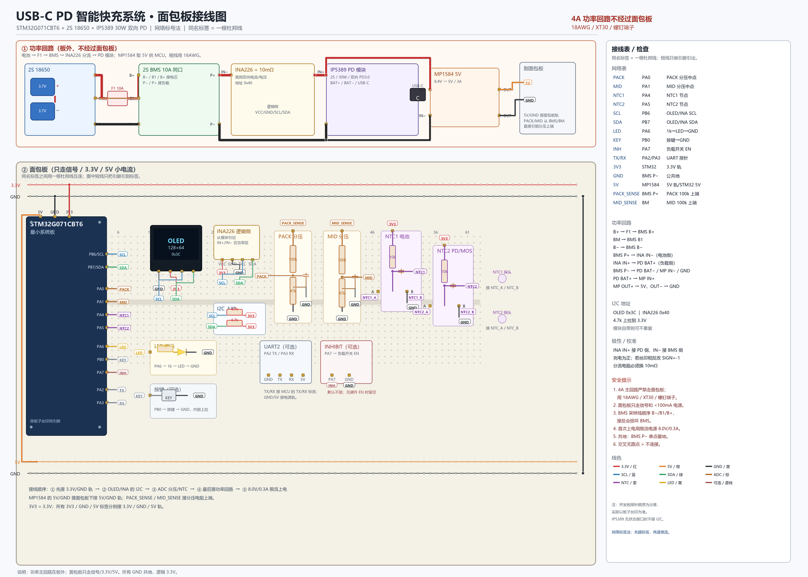

# USB-C PD 智能快充系统 · 软件集成与接线

> **适用**：STM32G071CBT6 最小系统板 + IP5389 2S/30 W 双向 PD 模块 + 2S BMS +
> INA226 + SSD1306 OLED + 2 路 NTC  
> **配套**：[软件设计说明](软件设计说明.md) · [软件工程](software/README.md) · [测试报告](测试报告.md)



> **逐根接线表**：[面包板接线图.md](面包板接线图.md)。图中采用网络标号法：
> 同名标签之间用一根杜邦线连接；4 A 功率回路在板外，不经过面包板。

---

## 1. 接线拓扑

```
[2S 电芯组] ──F1 10A── [2S BMS P+/P-] ──┬── [INA226 10mΩ 高侧] ── [PD 模块 BAT+]
                                        └────────────────────────── [PD 模块 BAT-]

[PD 模块 BAT+ / BAT-] ── [MP1584 8.4V→5V] ── [STM32 5V / OLED / INA226]
[PD 模块 USB-C] ◄──── 30W 双向 PD ────► [充电器 / 负载]

[电池组 + / 中点 / -] ── 100k/47k 分压 ── PA0 / PA1
[电池 NTC] ── 10k 上拉 ── PA4
[PD/MOS NTC] ── 10k 上拉 ── PA5
[OLED + INA226] ── PB6/PB7, 4.7k 上拉 ── 3.3V
```

要点：

1. **采样点放在 BMS 之后**（P+/P- 负载侧）。BMS 保护断开时，ADC 应能看到 0 V，
   从而报 UV/传感器故障；不要把分压直接接在电芯两端绕过 BMS。
2. INA226 分流器串在 **BMS P+ 与 PD 模块 BAT+** 之间，高侧测量；GND 参考电池负极。
   **IN− 接 BMS P+，IN+ 接 PD BAT+**，这样充电电流为正；若模块丝印/分流方向相反，
   实测后把 `APP_INA226_CURRENT_SIGN` 改为 `-1`。
3. 5 V 从 PD 模块 BAT+ 母线取，经 MP1584 降到 5 V，再给 STM32 板/OLED/INA226。
   不要从 USB-C VBUS 取，否则拔掉 USB-C 后 MCU 断电。
4. 分压电阻用 1% 或更好；ADC 引脚对地加 100 nF，靠近 MCU 放置。
5. NTC 的 10 kΩ 上拉接 **3.3 V**（不是 5 V），NTC 另一端接地；探头贴电芯侧面/
   PD 模块 MOS 或电感附近，用导热胶固定并绝缘。
6. **4 A 主回路不要经过面包板**：电池/BMS/INA226 的 IN+/IN−/PD/MP1584 输入用
   18AWG、XT30 或螺钉端子；面包板只走信号和 3.3V/5V 小电流。

---

## 2. 引脚分配

| STM32 引脚 | 功能 | 方向 | 说明 |
|------------|------|------|------|
| PA0 | ADC1_IN0 | 模拟 | 电池组总压，100 k/47 k |
| PA1 | ADC1_IN1 | 模拟 | 电池组中点，100 k/47 k |
| PA4 | ADC1_IN4 | 模拟 | 电池 NTC，10 k 上拉 |
| PA5 | ADC1_IN5 | 模拟 | PD/MOS NTC，10 k 上拉 |
| PB6 | I2C1_SCL | 开漏 | 4.7 k 上拉到 3.3 V |
| PB7 | I2C1_SDA | 开漏 | 4.7 k 上拉到 3.3 V |
| PA6 | GPIO_OUT | 推挽 | 故障 LED，高亮，串 1 k |
| PA7 | GPIO_OUT | 推挽 | 可选 inhibit，高=禁止输出 |
| PB0 | GPIO_IN | 上拉 | 用户按键，低有效（可选） |
| PA2 | USART2_TX | 复用 | 预留调试串口，当前未接日志 |
| PA3 | USART2_RX | 复用 | 预留 |
| PA13/PA14 | SWDIO/SWCLK | — | ST-Link |
| 5V / GND | 电源 | — | MP1584 5 V 输出 |

> 若使用 NUCLEO-G071RB，引脚名称相同但排针位置不同；以 CubeMX 的引脚图为准备份。

---

## 3. CubeMX 配置

### 3.1 时钟

- HSI 16 MHz → PLL → **64 MHz** SYSCLK。
- APB1 = 64 MHz；I2C1 时钟源选 PCLK（CubeMX 会自动算 TIMINGR）。
- **ADC 时钟 ≤ 32 MHz**：在 ADC 配置里选同步时钟 /4（64/4 = 16 MHz），
  或 /2（32 MHz）。不要超规格。
- **HAL 时基必须改成 TIM6**（1 ms），不要让 HAL 与 FreeRTOS 共用 SysTick。
  CubeMX：`SYS → Timebase Source = TIM6`。

### 3.2 ADC1

| 项目 | 设置 |
|------|------|
| Resolution | 12 bit |
| Scan Conversion | Disabled（软件逐通道） |
| Continuous Conversion | Disabled |
| Discontinuous | Disabled |
| External Trigger | Software start |
| Data Alignment | Right |
| Sampling Time | **160.5 cycles**（高阻分压） |
| Channels | IN0、IN1、IN4、IN5 |
| DMA | 不使用（驱动轮询） |

`bsp_adc_init()` 会调用 `HAL_ADCEx_Calibration_Start(&hadc1)`；请确保此时 ADC 未启动。

### 3.3 I2C1

| 项目 | 设置 |
|------|------|
| Mode | I2C |
| Speed | 400 kHz Fast Mode |
| Addressing | 7-bit |
| Analog Filter | Enable |
| Digital Filter | 0 |
| Clock No Stretch | Disable |
| Pins | PB6/PB7，开漏，无内部上拉 |

### 3.4 GPIO

- PA6：Output Push-Pull，初始 Low。
- PA7：Output Push-Pull，初始 Low（inhibit 关闭）。
- PB0：Input，Pull-up（若焊接按键）。
- PA13/PA14：SWD，保留。

### 3.5 FreeRTOS

- 使用 **原生 FreeRTOS**（不是 CMSIS-RTOS v1/v2 包装），因为代码直接调用
  `xTaskCreate`、`xSemaphoreCreateMutex`、`ulTaskNotifyTake`。
- 删除 CubeMX 默认生成的 `defaultTask`/`StartDefaultTask`，否则多一个无用任务。
- 堆：`configTOTAL_HEAP_SIZE = 12 * 1024`（见 `include/FreeRTOSConfig.h`）。
- Tick：1000 Hz，抢占式。
- `configMAX_PRIORITIES = 7`，任务优先级 5/4/2。
- 中断优先级：调用 FreeRTOS API 的 ISR 必须 ≥ `configLIBRARY_MAX_SYSCALL_INTERRUPT_PRIORITY`
  （数值上 ≥ 1；STM32G0 有 2 位优先级）。I2C/ADC 采用阻塞轮询，不配置中断。

> **FreeRTOSConfig.h 冲突**：CubeMX 生成 `Core/Inc/FreeRTOSConfig.h`。用本工程
> `software/include/FreeRTOSConfig.h` 覆盖，或逐项合并。CubeMX 重新生成后要再次检查，
> 尤其是 heap、优先级位、`configUSE_TIMERS` 和 `configASSERT`。

### 3.6 工程文件

把以下目录加入 CubeIDE 工程：

```
software/src/services/     (纯 C 算法)
software/src/drivers/      (INA226, SSD1306, 字库)
software/src/app/          (三任务, 状态, app_main)
software/platform/stm32g0/ (HAL 适配)
software/include/          (头文件路径)
```

在 `main.c` 的 `MX_*_Init()` 之后调用：

```c
/* USER CODE BEGIN 2 */
app_main();   /* 不返回 */
/* USER CODE END 2 */
```

并包含 `app_tasks.h`。`app_main()` 内部会启动调度器。

---

## 4. 分流电阻与校准

### 4.1 为什么必须换掉 R100

CJMCU-226 模块常见板载 **R100 = 0.1 Ω**。5 A 时压降 0.5 V、功耗 2.5 W，
远超 INA226 的 ±81.92 mV 差分范围，会饱和且发热。必须换成：

- **10 mΩ**，2512，≥1 W，0.5% 合金电阻（±8.192 A）；或
- 5 mΩ（±16.4 A），但小电流分辨率变差。

### 4.2 校准步骤

1. 用四线法/毫欧表测实际分流电阻 `R_actual`，例如 9.98 mΩ。
2. 修改 `APP_INA226_SHUNT_UOHM` 为 `9980`。
3. 用电子负载设定 1.000 A 放电，比较 OLED 电流与负载读数。
4. 若符号相反，把 `APP_INA226_CURRENT_SIGN` 改为 `-1`。
5. 若增益有 1~2% 偏差，优先相信实测 `R_actual`；不要在代码里加“神秘系数”。
6. 检查 `ina226_check_id()`：厂商 ID 0x5449、Die ID 0x2260。兼容片可能失败，
   但不影响测量；`APP_INA226_VERIFY_ID` 只作为诊断。

### 4.3 分压校准

1. 稳压电源输出 8.000 V，接在 BMS P+/P-（或分压输入端）。
2. 万用表测分压节点，记录实际值；同时看 OLED `PACK`。
3. 若误差 > 30 mV：
   - 优先换 0.1% 电阻；
   - 或按实测比例修改 `APP_PACK_DIVIDER_TOP_OHM/BOTTOM_OHM`
     （单体同理修改 `APP_CELL_DIVIDER_*`）。
4. 两节单体之和应等于总压（代码用 `cell2 = pack − mid` 保证一致）。

### 4.4 NTC 校准

1. 25 °C 恒温，读 OLED `T1/T2`，应在 24.5~25.5 °C。
2. 用 10 kΩ 精密电阻代替 NTC，读数应接近 25 °C；否则检查上拉是否为 10 kΩ、
   `APP_ADC_VREF_MV` 是否为实际 VDDA。
3. 若批量偏差，测量实际 R25/B 并修改 `APP_NTC_R25_OHM/APP_NTC_BETA`。
4. 拔掉 NTC 应显示 `N/A` 并置 `SENSOR_TEMP`；短接应显示短路故障。

---

## 5. PD 状态接口（可选）

### 5.1 默认：不读取

IP5389 模块通常只引出 BAT/KEY/LED/NTC，不提供 I2C 状态。默认
`APP_PD_STATUS_BACKEND=0`，固件不访问 0x2E，OLED 显示 `PD N/A (BLACK BOX)`。
这是正常状态，不是故障。

### 5.2 如果厂商开放接口

1. 向卖家索取：从机地址、寄存器/状态块格式、更新周期、协议码定义、是否需要
   解锁命令。
2. 若格式与 `pd_status.c` 的 v1 块不同，修改 `pd_status_poll()` 的解码；
   保持“只读、不写”的原则。
3. 设置：

```c
#define APP_PD_STATUS_BACKEND 1
#define APP_PD_I2C_ADDR       0x2E
#define APP_PD_REG_BASE       0x00
```

4. 用 USB-C 测试仪核对：20 V/1.5 A、15 V/2 A、PPS 等档位是否与 OLED 一致。
5. 若 2 s 内无更新，`PD_COMM` 告警，OLED 显示 `PD LINK STALE`。

> 不要为了“让 MCU 控制 PD”去改 IP5389 的反馈电阻或写入未知寄存器。需要自定义
> PDO/PPS 时，按设计说明第 9 节换 SC8815 + STM32 UCPD 方案。

---

## 6. 可选 inhibit 电路

默认不启用。若希望故障时切断 PD 输出，可加一个高侧负载开关：

```
BAT+ ── P-MOS (低 Rds_on, 30V) ── PD 模块 BAT+
              │
            100k 上拉到 BAT+
              │
        N-MOS 漏极
              │
PA7 ──100k── N-MOS 栅极
       │
     100k 下拉
```

- PA7 高 → N-MOS 导通 → P-MOS 栅极拉低 → 输出关闭。
- PA7 低/复位/掉电 → N-MOS 关断 → P-MOS 栅极被 100k 拉高 → 输出默认开启，
  避免 MCU 故障导致“全黑”，电芯仍由 BMS 保护。
- 若模块本身有低有效 EN 脚，可只用一个 N-MOS 反相，按实际逻辑修改
  `board_set_pd_inhibit()`。
- 启用后把 `APP_LOAD_INHIBIT_ENABLED` 改为 1，并用电子负载验证：
  过压/过流/过温时输出确实关断，故障清除+复位后恢复。

---

## 7. 上电与调试顺序

### 7.1 不上电芯

1. 稳压电源 8.0 V / 限流 0.3 A，接 BMS P+/P-。
2. 测 MP1584 输出 5.0 V，STM32 板 3.3 V。
3. ST-Link 能连接、下载、复位。
4. I2C 扫描：0x3C（OLED）、0x40（INA226）。若没有，先查上拉和供电。
5. OLED 应显示三页；无显示则查地址（0x3C/0x3D）、初始化命令、对比度。
6. 万用表对比 `PACK`/`T1`，误差在 ±30 mV / ±1 °C 内。
7. 电子负载 0.5 A/1 A，核对电流符号与功率。

### 7.2 上电芯

1. 电芯同批次、同内阻、同容量配组；2S2P 两两并联后再串联。
2. 先接 BMS，测 P+/P- 电压；确认无短路。
3. 接 PD 模块，USB-C 空载；测 5 V/3.3 V 无异常。
4. 插入充电器，确认充电电流、PD 档位（测试仪）。
5. 带 30 W 负载放电 10 min，摸 MOS/电感/线材温升；NTC 读数应跟随。
6. 做一次完整充放电，记录 SOC 曲线；若末端跳变，调整 OCV 表或容量。
7. 故障注入：OV（实验室电源 8.6 V）、OC（电子负载 8 A）、OT（热风/恒温箱），
   确认去抖、锁存、LED/OLED 行为。

### 7.3 故障排查

| 现象 | 可能原因 | 处理 |
|------|----------|------|
| OLED 全黑 | 地址不对/初始化失败/供电 | 扫描 I2C，查 0x3C，量 3.3 V |
| INA226 读不到 | R100 未换/地址/上拉 | 换 10 mΩ，查 0x40，查 4.7 k |
| 电流符号相反 | 分流器方向 | 改 `APP_INA226_CURRENT_SIGN=-1` |
| 电流始终 0 | 校准寄存器/量程 | 查 0x05 是否为 2048，查分流接线 |
| PACK 不准 | 分压电阻/VDDA | 实测分压，改电阻值 |
| NTC 显示 N/A | 开路/上拉错/ADC 通道 | 量 PA4/PA5 电压，查 10 k 上拉 |
| SOC 上电跳变 | 带载 OCV 播种 | 静置后自动修正；量产加持久化 |
| I2C 卡死 | 总线锁死/上拉不足 | 断电重启，查 SCL/SDA，必要时加总线恢复 |
| 系统不进任务 | 堆不足/中断优先级 | 查 `xTaskCreate` 返回值、heap、SysTick |
| 一上电就 inhibit | 故障锁存/LED 极性 | 看 OLED 故障页，查 PA7 电路 |

---

## 8. 目标板构建

本仓库的 `Makefile` 只构建 **主机测试**，不构建 STM32 固件。目标板构建：

1. STM32CubeIDE 新建 STM32G071CBT6 工程，按第 3 节配置。
2. 添加第 3.6 节源文件与头文件路径。
3. 用本工程 `include/FreeRTOSConfig.h` 覆盖生成文件。
4. 编译、下载。
5. 若用 Keil/IAR，同样添加源文件；注意 `-lm`（NTC 的 `log`）和 C11。

目标板编译前检查：

- [ ] `stm32g0xx_hal.h` 能找到，`hadc1`/`hi2c1` 已由 CubeMX 定义。
- [ ] FreeRTOS 内核版本 ≥ 10.3，`xTaskCreate` 等 API 可用。
- [ ] `FreeRTOSConfig.h` 的 `configTOTAL_HEAP_SIZE` ≥ 12 KB。
- [ ] HAL 时基为 TIM6，SysTick 只给 FreeRTOS。
- [ ] `app_main()` 在 `MX_*_Init()` 之后调用。
- [ ] `APP_LOAD_INHIBIT_ENABLED` 与实际硬件一致。
- [ ] 分流电阻、分压电阻、NTC 参数已按实测修改。

