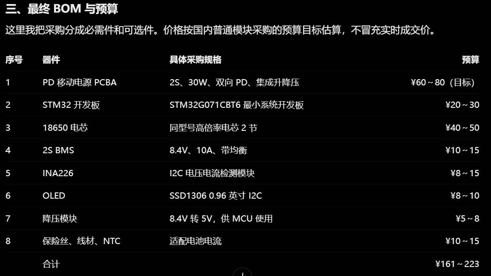

# USB-C PD 智能快充系统 · 采购清单

> **项目**：2S1P / 2S2P 18650 锂电池组 + 30W USB-C PD 双向快充 + STM32G071 主控  
> **编制日期**：2026-11-21  
> **预算基准**：图中 BOM 合计 **¥161 ~ 223**（不含调试工具、结构件与耗材）  
> **配套文件**：[参考-BOM预算.png](参考-BOM预算.png)  
> **软件部分**：[软件设计说明](软件设计说明.md) · [软件工程](software/README.md) · [软件集成与接线](软件集成与接线.md)



**链接说明**：芯片与规格明确的物料给的是立创 / 嘉立创 / 1688 商品页；模块类（PD 板、BMS、电芯）淘宝商品链接下架轮换很快，因此给的是**已填好关键词的搜索直达**，点开即可看到当前在售商品与实时价格。所有价格均为 2026-11 检索参考，下单前请与客服确认规格。

---

## 1. 选型总览

| # | 器件 | 建议型号 / 规格 | 图中预算 | 建议渠道 | 关键提醒 |
|---|------|----------------|---------|---------|---------|
| 1 | PD 移动电源 PCBA | 英集芯 **IP5389-BZ** 方案，2S，30W，双向 PD3.0/PPS，集成同步升降压 | ¥60 ~ 80 | 淘宝 / 1688 | 必须确认是「2 串 + 30W」版本，不是 1S/3S 固定版 |
| 2 | STM32 开发板 | **STM32G071CBT6** 最小系统板（LQFP-48，128KB Flash，36KB RAM） | ¥20 ~ 30 | 淘宝 / 立创 | 另配 ST-Link V2 下载器（约 ¥10 ~ 15，图中未列） |
| 3 | 18650 电芯 | **三星 INR18650-25R**（2500mAh / 20A）2 节，同批次分容配组 | ¥40 ~ 50 | 淘宝 / 1688 | 30W 放电约 4.1A、充电约 3.6A，20A 电芯余量充足 |
| 4 | 2S BMS | 2 串 8.4V，持续 **10A**，带均衡，同口，过充/过放/过流/短路保护 | ¥10 ~ 15 | 淘宝 / 1688 | 优先「同口」板；均衡电流通常仅 30 ~ 50mA |
| 5 | INA226 | INA226AIDGSR 模块（CJMCU-226）或裸芯片 + 10mΩ 分流器 | ¥8 ~ 15 | 立创 / 淘宝 / 1688 | 模块自带 R100（0.1Ω）必须换掉，否则 5A 时压降 0.5V |
| 6 | OLED | 0.96 寸 SSD1306 128×64，**4 针 I2C**，3.3V | ¥8 ~ 10 | 立创 / 淘宝 | 买 4 针 I2C 版，别买 7 针 SPI 默认版 |
| 7 | 降压模块 | **MP1584EN** 3A 降压模块，4.5 ~ 28V 输入，输出设 5.0V | ¥5 ~ 8 | 淘宝 / 立创 | 8.4V 输入在范围内；负载仅几十 mA，余量很大 |
| 8 | 保险丝 / 线材 / NTC | 10A 保险丝、18AWG 硅胶线、XT30U、10K B3950 NTC | ¥10 ~ 15 | 淘宝 / 1688 | 保险丝按 1.5 ~ 2 倍工作电流选，慢断更合适 |
| | **合计** | | **¥161 ~ 223** | | 实际约 ¥156 ~ 233，见第 3 节 |

### 1.1 链接速查表

| # | 器件 | 首选链接 | 备选链接 |
|---|------|---------|---------|
| 1 | PD 模块 | [淘宝：IP5389 2 串 30W 双向](https://s.taobao.com/search?q=IP5389%202%E4%B8%B2%2030W%20%E5%8F%8C%E5%90%91%E6%A8%A1%E5%9D%97) | [1688：IP5389 2 串 30W](https://s.1688.com/selloffer/offer_search.htm?keywords=IP5389%202%E4%B8%B2%2030W%20%E6%A8%A1%E5%9D%97) |
| 2 | STM32 开发板 | [淘宝：STM32G071CBT6 最小系统板](https://s.taobao.com/search?q=STM32G071CBT6%20%E6%9C%80%E5%B0%8F%E7%B3%BB%E7%BB%9F%E6%9D%BF) | [立创：STM32G071CBT6（C432212）](https://www.jlc-smt.com/lcsc/detail/C432212.html) |
| 3 | 18650 电芯 | [淘宝：三星 25R](https://s.taobao.com/search?q=%E4%B8%89%E6%98%9F25R%2018650%20%E5%8A%A8%E5%8A%9B%E7%94%B5%E8%8A%AF) | [1688：高倍率电芯](https://s.1688.com/selloffer/offer_search.htm?keywords=18650%20%E9%AB%98%E5%80%8D%E7%8E%87%20%E5%8A%A8%E5%8A%9B%E7%94%B5%E8%8A%AF) |
| 4 | 2S BMS | [淘宝：2 串 10A 均衡](https://s.taobao.com/search?q=2%E4%B8%B2%208.4V%2010A%20%E4%BF%9D%E6%8A%A4%E6%9D%BF%20%E5%B8%A6%E5%9D%87%E8%A1%A1) | [1688：2 串 10A 均衡](https://s.1688.com/selloffer/offer_search.htm?keywords=2%E4%B8%B2%208.4V%2010A%20%E4%BF%9D%E6%8A%A4%E6%9D%BF%20%E5%9D%87%E8%A1%A1) |
| 5 | INA226 | [立创/嘉立创：INA226AIDGSR（C49851）](https://www.jlc-smt.com/lcsc/detail/C49851.html) | [淘宝：CJMCU-226 模块](https://s.taobao.com/search?q=INA226%20%E6%A8%A1%E5%9D%97%20CJMCU-226) |
| 6 | OLED | [立创：0.96 寸 I2C（C5248080）](https://item.szlcsc.com/5960631.html) | [淘宝：SSD1306 I2C](https://s.taobao.com/search?q=0.96%E5%AF%B8%20OLED%20SSD1306%20I2C) |
| 7 | 降压模块 | [淘宝：MP1584EN 5V（¥2.20 参考）](https://www.taobao.com/list/item/641791302928.htm) | [立创：MP1584EN 芯片](https://item.szlcsc.com/15724.html) |
| 8 | 保险丝/线材/NTC | [1688：0805 NTC](https://detail.1688.com/offer/601118401461.html) | [淘宝：10A 保险丝](https://s.taobao.com/search?q=10A%20%E4%BF%9D%E9%99%A9%E4%B8%9D%205%C3%9720) / [XT30U 线材](https://s.taobao.com/search?q=XT30U%20%E6%8F%92%E5%A4%B4%2018AWG%20%E7%A1%85%E8%83%B6%E7%BA%BF) |

---

## 2. 逐项采购链接与说明

### 2.1 PD 移动电源 PCBA（2S / 30W / 双向 PD）

**选型理由**：IP5389 是英集芯的移动电源 SOC，支持 **2 ~ 5 串**电芯，片内集成同步升降压控制器、PD2.0/PD3.0/PPS、QC/AFC/FCP/SCP 等协议、电量显示与 NTC 保护。2S 下 30W 对应约 **3.6A 充电 / 4.1A 放电**，与 10A BMS、20A 电芯匹配。相比 SW3516H（只能降压、不能从 7.4V 升到 20V）、SW6208（22.5W 升压方案、功率与拓扑都不匹配），IP5389 是本项目最省事的选择。

**采购链接**
- 淘宝（关键词已填）：[IP5389 2 串 30W 双向模块](https://s.taobao.com/search?q=IP5389%202%E4%B8%B2%2030W%20%E5%8F%8C%E5%90%91%E6%A8%A1%E5%9D%97)
- 1688（批量/比价）：[IP5389 2 串 30W 模块](https://s.1688.com/selloffer/offer_search.htm?keywords=IP5389%202%E4%B8%B2%2030W%20%E6%A8%A1%E5%9D%97)
- 备选 65W 方案：[IP5385 双向模块](https://s.taobao.com/search?q=IP5385%20%E5%8F%8C%E5%90%91%E6%A8%A1%E5%9D%97)
- 超预算参考：[IP5389 100W 双向模块](https://s.taobao.com/search?q=IP5389%20100W%20%E6%A8%A1%E5%9D%97)（检索价约 ¥191，仅作备选）

**参考价**：30W 模块约 ¥45 ~ 85；65W 模块约 ¥60 ~ 100；100W 模块约 ¥150 ~ 200。图中 ¥60 ~ 80 是「目标价」，能买到 30W 板最好；若只有 100W 板，预算要上浮约 ¥100。

**下单前逐项确认**
- [ ] 电芯串数：**2S（7.4V，充满 8.4V）**，不是 1S 或 3S 固定版
- [ ] 功率档：30W；或确认可通过 PMAX 电阻 / 拨码改到 30W（IP5389 规格书中 PMAX 约 9.1kΩ 对应 30W，具体以模块资料为准）
- [ ] **双向**：既能 USB-C 输入给电池充电，也能电池升压输出 PD
- [ ] 带 NTC 接口（10K B3950）、按键、电量显示
- [ ] 功率 MOS / 电感余量 ≥ 5A，输出电容耐压 ≥ 25V
- [ ] 向卖家索取接线图：BAT+、BAT-、USB-C、NTC、KEY、LED
- [ ] 确认模块是否带 e-marker / 是否支持 20V 档（30W 通常 20V/1.5A 或 15V/2A）

**注意**：这类模块对 MCU 是「黑盒」，STM32 不能直接改 PD 电压档位。本方案中 STM32 负责电流/电压监测、OLED 显示、温度与保护逻辑，PD 协商由模块完成。若要求 MCU 全程控制 PD，见第 7 节升级路线。

---

### 2.2 STM32G071CBT6 开发板

**选型理由**：STM32G071CBT6 是 Cortex-M0+ @64MHz、128KB Flash、36KB RAM、LQFP-48，片上带 **UCPD**（USB Type-C PD 外设）、2 路 I2C、多通道 ADC，正好覆盖本项目「I2C 外设 + ADC 测温 + 未来可自己做 PD」的需求。

**采购链接**
- 淘宝（最小系统板，首选）：[STM32G071CBT6 最小系统板](https://s.taobao.com/search?q=STM32G071CBT6%20%E6%9C%80%E5%B0%8F%E7%B3%BB%E7%BB%9F%E6%9D%BF)
- 芯片（立创/嘉立创，C432212，参考价约 ¥10/片，检索时显示可预订）：[STM32G071CBT6](https://www.jlc-smt.com/lcsc/detail/C432212.html)
- 官方评估板备选（约 ¥70 ~ 90，超预算但资料最全）：[NUCLEO-G071RB](https://www.st.com/en/evaluation-tools/nucleo-g071rb.html)
- 下载器：[ST-Link V2](https://s.taobao.com/search?q=ST-Link%20V2%20%E4%B8%8B%E8%BD%BD%E5%99%A8)

**参考价**：最小系统板 ¥20 ~ 30；裸芯片 ¥10 左右；NUCLEO-G071RB ¥70 ~ 90。

**下单前确认**
- [ ] 型号是 **STM32G071CBT6**（CBT6TR 为同型号编带版，也可），不是 C8T6（64KB）
- [ ] 板载 3.3V LDO，支持 5V 输入（方便直接接 MP1584 的 5V 输出）
- [ ] 引出 SWD（SWDIO/SWCLK/GND/3V3）、I2C1/I2C2、USART、ADC 引脚
- [ ] 晶振/复位/BOOT0 电路完整，排针已焊或自备

**注意**：如果买裸芯片自己画板，首版调试成本会明显高于买最小系统板；建议第一版直接买板，验证通过后再考虑自绘 PCB。

---

### 2.3 18650 电芯（2S1P 用 2 节 / 2S2P 用 4 节）

**选型理由**：30W 输出时电池侧电流约 **4.1A**（7.4V），30W 充电时约 **3.6A**（8.4V）。三星 25R 标称 2500mAh、连续放电 20A，余量充足且价格适中；同级别可选 Molicel P26A/P28A、LG HG2。**不要**用低倍率容量型电芯（如 35E，8A 级）做 30W 双向。

**采购链接**
- 淘宝：[三星 25R 18650 动力电芯](https://s.taobao.com/search?q=%E4%B8%89%E6%98%9F25R%2018650%20%E5%8A%A8%E5%8A%9B%E7%94%B5%E8%8A%AF)
- 1688（批量/配组）：[18650 高倍率动力电芯](https://s.1688.com/selloffer/offer_search.htm?keywords=18650%20%E9%AB%98%E5%80%8D%E7%8E%87%20%E5%8A%A8%E5%8A%9B%E7%94%B5%E8%8A%AF)
- 2S2P 结构件：[18650 电池支架 / 镍带](https://s.taobao.com/search?q=18650%20%E7%94%B5%E6%B1%A0%E6%94%AF%E6%9E%B6%20%E9%95%8D%E5%B8%A6)

**参考价**：正品 25R 约 ¥20 ~ 28/节，2 节约 ¥40 ~ 56；拆机/假货常见 ¥10 ~ 15，不建议。

**下单前确认**
- [ ] 全新原装 A 品，非拆机、非打磨重包
- [ ] 提供**分容容量 + 内阻**数据；2 节（或 4 节）内阻差 ≤ 5mΩ、容量差 ≤ 3%
- [ ] 平头/尖头按电池座或点焊方案选；2S2P 建议点焊 + 支架，不要只靠弹簧座
- [ ] 生产日期尽量新（半年内），避免长期库存自放电

**容量与续航**：2S1P 2500mAh ≈ 18.5Wh，30W 输出约 **25 ~ 30 分钟**（含效率）；2S2P 5000mAh ≈ 37Wh，约 **55 ~ 65 分钟**。

---

### 2.4 2S BMS（8.4V / 10A / 带均衡）

**选型理由**：BMS 是电芯的最后一道保护，负责过充、过放、过流、短路与均衡。30W 工况下持续电流 ≤ 4.5A，10A 板有 2 倍余量；「同口」板充放电共用一个 P+/P-，接线最简单。

**采购链接**
- 淘宝：[2 串 8.4V 10A 保护板 带均衡](https://s.taobao.com/search?q=2%E4%B8%B2%208.4V%2010A%20%E4%BF%9D%E6%8A%A4%E6%9D%BF%20%E5%B8%A6%E5%9D%87%E8%A1%A1)
- 1688：[2 串 10A 均衡保护板](https://s.1688.com/selloffer/offer_search.htm?keywords=2%E4%B8%B2%208.4V%2010A%20%E4%BF%9D%E6%8A%A4%E6%9D%BF%20%E5%9D%87%E8%A1%A1)

**参考价**：¥8 ~ 15（普通 10A 板约 ¥6 ~ 12，带均衡/大电流 MOS 的约 ¥12 ~ 18）。

**下单前确认**
- [ ] **同口**（充放电同口），不是分口
- [ ] 持续 10A、瞬时 20A；MOS 有散热铜箔
- [ ] 过充截止 4.25V±0.05V/节，过放 2.9V±0.1V/节
- [ ] 均衡功能（被动均衡即可），均衡电流 30 ~ 50mA
- [ ] 板长/开孔与电池支架、外壳匹配；最好带 NTC 接口

**注意**：BMS 的均衡电流很小，只适合「同批次、已配组」的电芯；不要指望它修复严重不一致的电池组。BMS 与 IP5389 模块的充电截止电压都按 8.4V 设计，二者串联不会冲突，但要注意线损与接触电阻。

---

### 2.5 INA226 电压电流检测

**选型理由**：INA226 是 16 位、I2C 接口、支持 0 ~ 36V 共模的双向电流/功率监测芯片，非常适合 2S（8.4V）电池侧库仑计与充放电功率显示。

**采购链接**
- 芯片（立创/嘉立创，C49851，参考价约 ¥2.3/片，检索时显示可预订）：[INA226AIDGSR](https://www.jlc-smt.com/lcsc/detail/C49851.html)
- 1688 芯片：[INA226AIDGSR 一站式配单](https://detail.1688.com/offer/1095342515165.html)
- 淘宝模块：[INA226 模块 CJMCU-226](https://s.taobao.com/search?q=INA226%20%E6%A8%A1%E5%9D%97%20CJMCU-226)
- 采样电阻：[2512 合金采样电阻 10mΩ](https://s.taobao.com/search?q=2512%20%E5%90%88%E9%87%91%E9%87%87%E6%A0%B7%E7%94%B5%E9%98%BB%2010m%CE%A9)

**参考价**：模块 ¥8 ~ 15；裸芯片约 ¥2.5 ~ 5（视批次/渠道）；10mΩ 2512 电阻几毛钱。

**关键注意（必看）**
- CJMCU-226 模块通常板载 **R100 = 0.1Ω** 采样电阻，5A 时压降 0.5V、功耗 2.5W，既超 INA226 的 ±81.92mV 差分范围，也会严重发热。**必须换成 10mΩ（±8.19A）或 5mΩ（±16.4A）合金电阻**（2512 封装、1W 以上、0.5% 精度）。
- 分流器放在 **BMS P+ 与 PD 模块 BAT+ 之间**，高侧测量，GND 接电池负极；充放电电流方向相反，INA226 可双向读数。
- I2C 地址默认 **0x40**（A0/A1 接地）；OLED 常用 **0x3C**，可共用一条 I2C 总线。
- 上拉电阻 2.2 ~ 4.7kΩ 到 3.3V；走线尽量短，远离电感和 PD 模块的开关节点。
- 校准时以实测分流电阻值为准，不要直接用标称 10mΩ；`Current_LSB = Max_Current / 32768`。

---

### 2.6 OLED 显示（0.96 寸 / SSD1306 / I2C）

**选型理由**：0.96 寸 128×64、SSD1306 驱动、4 针 I2C，3.3V 供电，与 STM32 直接相连；显示电压、电流、功率、温度、电量、PD 档位足够。

**采购链接**
- 立创（C5248080，0.96 寸 I2C 白光，SSD1315 驱动）：[HS96L03W2C03 OLED 模块](https://item.szlcsc.com/5960631.html)
- 淘宝：[0.96 寸 OLED SSD1306 I2C](https://s.taobao.com/search?q=0.96%E5%AF%B8%20OLED%20SSD1306%20I2C)

**参考价**：¥8 ~ 12（4 针 I2C 白色/蓝色）。

**下单前确认**
- [ ] **4 针 I2C**（GND/VCC/SCL/SDA），不是 7 针 SPI 默认版
- [ ] 驱动 SSD1306 或 SSD1315（两者指令兼容，常见库均可驱动），分辨率 128×64
- [ ] 3.3V 供电（模块板载电荷泵，3.3V 即可点亮）
- [ ] I2C 地址 0x3C 或 0x3D，购买时确认

---

### 2.7 降压模块（8.4V → 5V，供 MCU）

**选型理由**：MP1584EN 输入 4.5 ~ 28V、输出 0.8 ~ 25V、最大 3A，8.4V 输入余量充足；模块体积小、价格低，输出设 5.0V 给 STM32 板、OLED、INA226 供电，总负载通常 < 100mA。

**采购链接**
- 淘宝（固定 5V 版，检索价约 ¥2.20）：[MP1584EN 降压模块 5V](https://www.taobao.com/list/item/641791302928.htm)
- 淘宝搜索（多规格比价）：[MP1584EN 降压模块](https://s.taobao.com/search?q=MP1584EN%20%E9%99%8D%E5%8E%8B%E6%A8%A1%E5%9D%97%205V)
- 立创芯片（自绘板用）：[MP1584EN-LF-Z](https://item.szlcsc.com/15724.html)

**参考价**：模块 ¥2 ~ 5；图中 ¥5 ~ 8 含备件/运费是合理的。

**下单前确认**
- [ ] 输出**固定 5V** 版（可调版要自己调电位器，易误设）
- [ ] 输入电容耐压 ≥ 25V，输出加 22µF + 0.1µF
- [ ] 8.4V 输入时效率约 85% ~ 90%，模块温升可接受
- [ ] 若 STM32 板 5V 输入经 LDO 转 3.3V，注意 LDO 压差与散热（负载小，问题不大）

---

### 2.8 保险丝、线材、NTC

**选型理由**：2S 锂电必须有的三样小件——主回路保险丝、低阻大电流线材与连接器、温度检测 NTC。它们单价低，但直接决定安全与可靠性。

**采购链接**
- NTC（1688，0805 10K B3950，约 ¥0.31）：[贴片 NTC 10K 3950](https://detail.1688.com/offer/601118401461.html)
- 保险丝：[10A 保险丝 5×20](https://s.taobao.com/search?q=10A%20%E4%BF%9D%E9%99%A9%E4%B8%9D%205%C3%9720)
- 线材/插头：[XT30U 插头 + 18AWG 硅胶线](https://s.taobao.com/search?q=XT30U%20%E6%8F%92%E5%A4%B4%2018AWG%20%E7%A1%85%E8%83%B6%E7%BA%BF)
- NTC 探头（电池包测温）：[NTC 10K B3950 探头](https://s.taobao.com/search?q=NTC%2010K%20B3950%20%E6%8E%A2%E5%A4%B4)

**参考价**：保险丝 ¥1 ~ 3/只；18AWG 硅胶线 ¥2 ~ 4/米；XT30U ¥2 ~ 4/对；NTC ¥1 ~ 3/只；合计 ¥10 ~ 20。

**下单前确认**
- [ ] 保险丝：**10A 慢断**（或 7.5A），5×20mm 带座；额定电压 ≥ 32V
- [ ] 线材：电池主回路 **18AWG** 硅胶线（红/黑），信号线 24 ~ 26AWG
- [ ] 连接器：XT30U（持续 15 ~ 20A）足够；2S2P 大电流可选 XT60
- [ ] NTC：**10K B3950**，与 IP5389 模块的 NTC 参数一致；电池包用带引线探头
- [ ] 热缩管、青稞纸、绝缘胶带、18650 支架（2S2P 必买）

---

## 3. 预算汇总

| 项目 | 低 | 高 | 说明 |
|------|---:|---:|------|
| 1. PD 移动电源 PCBA | ¥60 | ¥80 | 30W 模块目标价；100W 模块约 ¥191，需另加预算 |
| 2. STM32 开发板 | ¥20 | ¥30 | 不含 ST-Link（¥10 ~ 15） |
| 3. 18650 电芯 ×2 | ¥40 | ¥56 | 25R 正品约 ¥20 ~ 28/节 |
| 4. 2S BMS | ¥8 | ¥15 | 10A 同口带均衡 |
| 5. INA226 | ¥8 | ¥15 | 模块价；裸芯片约 ¥2.5 ~ 5 |
| 6. OLED | ¥8 | ¥12 | 0.96 寸 I2C |
| 7. 降压模块 | ¥2 | ¥5 | MP1584EN 固定 5V |
| 8. 保险丝/线材/NTC | ¥10 | ¥20 | 含热缩管、XT30U |
| **合计** | **¥156** | **¥233** | 与图中 ¥161 ~ 223 基本一致 |

**未计入图中的追加项**

| 项目 | 参考价 | 是否必须 |
|------|---:|---------|
| ST-Link V2 下载器 | ¥10 ~ 15 | 必须（调试/烧录） |
| USB-C 测试仪（电压/电流/协议） | ¥30 ~ 60 | 强烈建议（验证 PD 档位） |
| 18650 支架 + 镍带 + 热缩管（2S2P） | ¥15 ~ 30 | 2S2P 必须 |
| 2S2P 追加 2 节电芯 | ¥40 ~ 56 | 2S2P 必须 |
| 外壳 / 亚克力 / 3D 打印 | ¥20 ~ 60 | 按需 |

---

## 4. 建议下单顺序

1. **先买开发板 + ST-Link**：STM32G071 最小系统板、ST-Link V2。先点灯、跑通 I2C（OLED/INA226 可后到），确认工具链（STM32CubeIDE / Keil）可用。
2. **同时买 PD 模块与 BMS**：这两件决定整体方案，先与卖家确认 2S/30W/同口/接线图，避免买错版本。电芯可同店或另找信誉店。
3. **立创/嘉立创一单补齐**：INA226、OLED、MP1584、采样电阻、接插件、阻容。正品、有发票、到货快。
4. **最后买结构件与耗材**：保险丝、硅胶线、XT30U、NTC、支架、镍带、热缩管。按实际外壳尺寸下单，避免长短不合适。

> 电芯建议**最后焊/最后上电**：先让 PD 模块 + BMS + 电子负载/电阻测试通过，再配电芯，降低炸机风险。

---

## 5. 接线拓扑与兼容性检查

### 5.1 建议拓扑

```
[2S 电芯组] ──F1(10A)── [BMS P+/P-] ──┬── [INA226 + 10mΩ] ── [PD 模块 BAT+]
                                       └────────────────────── [PD 模块 BAT-]

[PD 模块 BAT+ / BAT-] ── [MP1584: 8.4V→5V] ── [STM32 / OLED / INA226]
[PD 模块 USB-C 口] ◄──── 30W 双向 PD ────► [充电器 / 负载]
```

- 保险丝 F1 尽量靠近电芯正极；BMS 在电芯与负载之间；INA226 分流器串在 BMS P+ 与 PD 模块 BAT+ 之间，测的是**充放电总电流**。
- 5V 从 PD 模块的 BAT+ 母线取电（8.4V），经 MP1584 降到 5V；不要从 USB-C VBUS 取电，否则拔掉 USB-C 后 MCU 断电。

### 5.2 2S1P 与 2S2P

| 项目 | 2S1P | 2S2P |
|------|------|------|
| 电芯数 | 2 | 4（两并两串） |
| 容量 | 2500mAh / 18.5Wh | 5000mAh / 37Wh |
| 30W 时单节电流 | 约 4.1A | 约 2.05A |
| BMS | 10A 同口 | 10A 同口（可升级 15 ~ 20A） |
| 结构 | 电池座/点焊 + 热缩 | 支架 + 镍带 + 点焊，必须配组 |
| 续航（30W 输出） | 约 25 ~ 30 分钟 | 约 55 ~ 65 分钟 |

2S2P 的 4 节电芯必须**同批次、同内阻、同容量**，两两并联后再串联；不要混用新旧电芯。

### 5.3 关键检查清单

- [ ] **PD 模块 2S 配置**：确认模块不是 1S/3S 固定版；30W 档已设定或可改。
- [ ] **BMS 同口**：充放电共用 P+/P-；若买成分口，需分别布充电/放电回路，INA226 位置也要改。
- [ ] **INA226 分流器**：换 10mΩ（5A 级）或 5mΩ（10A 级）；2512、≥1W、0.5%。
- [ ] **I2C 地址不冲突**：OLED 0x3C、INA226 0x40；上拉 4.7kΩ 到 3.3V。
- [ ] **5V 负载**：STM32 板 + OLED + INA226 合计 < 100mA，MP1584 余量充足。
- [ ] **保险丝**：10A 慢断，额定电压 ≥ 32V；30W 工作电流 4.5A，1.5 ~ 2 倍余量。
- [ ] **NTC**：10K B3950，一只贴电芯侧面，一只贴 PD 模块 MOS/电感；STM32 ADC 分压读取电池温度。
- [ ] **USB-C 线**：用支持 3A 以上、线芯粗的 60W/100W 线；30W 不强制 e-marker，但 100W 线更稳，差线会掉压/发热。
- [ ] **绝缘与固定**：电芯之间青稞纸/支架隔离，镍带不外露，外壳阻燃。
- [ ] **首次上电**：先不接电芯，用稳压电源 8.4V/限流 0.5A 模拟电池，确认 5V、3.3V、I2C、OLED 正常，再上电芯。

### 5.4 已知限制

- IP5389 模块的 PD 档位、充电电流由模块自身决定，STM32 只能「看」不能「改」；想做动态功率分配/自定义 PDO，需要第 7 节的 SC8815 + UCPD 方案。
- INA226 只测瞬时电流/电压，库仑计（mAh）需要 STM32 定时积分；采样周期建议 100 ~ 500ms。
- 2S 没有「单节 4.2V 升压」的效率优势，30W 输出时电池电流约 4.1A，线损与 MOS 发热要留余量。

---

## 6. 风险提示

1. **链接与价格时效**：本清单检索于 2026-11-21。淘宝商品 ID 会轮换、价格随行就市；模块类给的是搜索直达，购买前请核对型号、串数、功率与接线图。
2. **电芯真伪**：25R 是假货/拆机重包的重灾区。低于 ¥15/节且无法提供分容数据的，不建议用于 30W 双向。优先选有品牌授权、支持验货的店。
3. **30W 2S 模块较少**：市面上 IP5389 模块以 100W 居多（约 ¥191），30W 板可能需定制或选 IP5385 65W 板。若预算严格卡 ¥80，建议先与卖家确认「2S + 30W + 双向」再下单。
4. **BMS 均衡能力有限**：被动均衡 30 ~ 50mA，只适合已配组电芯；不要用 BMS 去「救」严重不一致的电池组。
5. **安全**：锂电充电必须有人值守；8.4V 充电截止、10A 保险丝、BMS、阻燃外壳、防反接一个都不能省。首次测试用限流电源，别直接上满电电芯。
6. **合规**：若做成商品出售，需考虑 USB PD 认证、电池运输 UN38.3、CE/FCC 等；自用样机可先跳过，但安全项不能省。

---

## 7. 后续可升级路线

| 方向 | 方案 | 收益 | 代价 |
|------|------|------|------|
| MCU 全程控 PD | **SC8815**（I2C 双向升降压）+ STM32G071 的 UCPD + PD 协议栈 | 可自定义 PDO/PPS、动态功率、真正「智能」 | 需写固件/调协议，开发周期长 |
| 更大功率 | IP5385 65W / IP5389 100W 模块 | 65W/100W 输出，充笔记本 | 成本、散热、电芯要求更高 |
| 更大容量 | 2S2P（4 节 25R） | 30W 续航约 1 小时 | 结构、配组、重量 |
| 更准电量 | INA226 电池侧 + VBUS 侧各一颗 | 输入/输出/电池三路功率与库仑计 | 多一颗 INA226 + 固件 |
| 智能互联 | ESP32/蓝牙模块 + STM32 | 手机查看曲线、远程关断 | 增加成本与功耗 |

---

## 附：搜索关键词速查

| 目标 | 淘宝关键词 | 1688 关键词 |
|------|-----------|-------------|
| PD 模块 | `IP5389 2串 30W 双向模块` | `IP5389 2串 30W 模块` |
| MCU 板 | `STM32G071CBT6 最小系统板` | `STM32G071CBT6 开发板` |
| 电芯 | `三星25R 18650 动力电芯` | `18650 高倍率 动力电芯` |
| BMS | `2串 8.4V 10A 保护板 带均衡` | `2串 10A 均衡保护板` |
| INA226 | `INA226 模块 CJMCU-226` | `INA226AIDGSR` |
| OLED | `0.96寸 OLED SSD1306 I2C` | `0.96 OLED 模块 I2C` |
| 降压 | `MP1584EN 降压模块 5V` | `MP1584EN 模块` |
| 保险丝 | `10A 保险丝 5×20` | `10A 慢断 保险丝` |
| 线材 | `XT30U 插头 18AWG 硅胶线` | `18AWG 硅胶线` |
| NTC | `NTC 10K B3950 探头` | `0805 10K 3950` |
