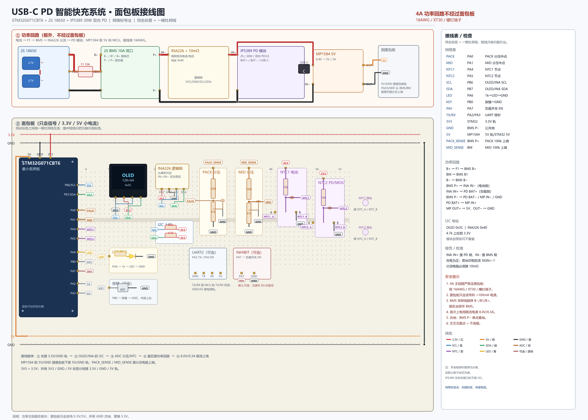

# USB-C PD 智能快充系统 · 面包板接线图与网络表

> **用途**：给样机搭面包板时逐根对照接线。  
> **原则**：4 A 功率主回路**不经过面包板**，面包板只走信号、3.3 V 和 5 V 小电流。  
> **配套**：[软件集成与接线](软件集成与接线.md) · [软件设计说明](软件设计说明.md) · [采购清单](采购清单.md)



---

## 1. 读图方法：网络标号法

图中每个引脚先引出一小段杜邦线，末端是一个**网络标签**（例如 `PACK`、`SCL`、`NTC1`）。
**同名标签之间用一根杜邦线连接**；没有画长线，是为了避免 20 多根线互相遮挡。

例如：

- STM32 的 `PA0` 旁边有 `PACK` 标签；
- PACK 分压中点也有 `PACK` 标签；
- 用一根杜邦线把这两个点连起来即可。

这样比“一根线从 MCU 拉到板子另一端”更容易检查，也不容易插错。

> 图中开发板排针顺序是示意，**实际以你手里的 STM32G071 最小系统板丝印为准**。
> 只要按“引脚名”找，不要按图中位置找。

---

## 2. 功率回路（板外，18AWG）

功率回路不上面包板，使用 XT30 / 螺钉端子 / 18AWG 硅胶线。

| # | 从 | 到 | 说明 |
|---|----|----|------|
| 1 | 电池组 B+ | F1 10A 慢断 | 保险丝靠近电芯正极 |
| 2 | F1 另一端 | BMS B+ | BMS 电池侧正极 |
| 3 | 电池组中点 BM | BMS B1 | 2S 均衡/采样中点 |
| 4 | 电池组 B− | BMS B− | BMS 电池侧负极 |
| 5 | BMS P+ | INA226 **IN−** | 电池侧（protected positive） |
| 6 | INA226 **IN+** | PD 模块 BAT+ | 负载/充电器侧 |
| 7 | BMS P− | PD 模块 BAT− | 公共负极 |
| 8 | BMS P− | MP1584 IN− | 5 V 降压输入负极 |
| 9 | PD 模块 BAT+ | MP1584 IN+ | 5 V 降压输入正极 |
| 10 | MP1584 OUT+ | 面包板下排 **5V** 轨 | 供 STM32 5V |
| 11 | MP1584 OUT− | 面包板下排 **GND** 轨 | 与 BMS P− 共地 |

### 2.1 为什么 INA226 的 IN+ 接 PD 侧、IN− 接 BMS 侧？

INA226 规定电流从 **IN+ 流向 IN−** 时读数为正。本产品约定**充电为正、放电为负**：

```
充电：PD BAT+ → INA IN+ → 分流电阻 → INA IN− → BMS P+ → 电池
放电：电池 → BMS P+ → INA IN− → 分流电阻 → INA IN+ → PD BAT+
```

所以：

- `APP_INA226_CURRENT_SIGN = 1`（默认）时，充电显示正电流；
- 若模块丝印/分流方向相反，实测充电为负，则改为 `-1`；
- 不要靠“反接电池”去纠正符号。

> 分流电阻必须是 **10 mΩ**，不是 CJMCU-226 板载的 0.1 Ω。  
> 5 A 时 0.1 Ω 会产生 0.5 V 压降和 2.5 W 发热，且超出 INA226 的 ±81.92 mV 范围。

### 2.2 单点星地

所有 GND 在 **BMS P−** 处汇合：

```
BMS P− ──┬── PD BAT−
         ├── MP1584 IN−
         ├── MP1584 OUT−
         └── 面包板 GND 轨
```

不要把电池 B− 直接当负载地；B− 只到 BMS B−。BMS 的 MOS 在 P− 回路上，跳过 BMS 就失去保护。

---

## 3. 面包板网络表

### 3.1 电源

| 网络 | 源 | 去向 | 备注 |
|------|----|------|------|
| `3V3` | STM32 3.3V 引脚 | 3.3V 轨：OLED VCC、INA226 VCC、NTC 10k 上拉、I2C 4.7k 上拉 | 不要接 5V；`3V3` 即 3.3V |
| `5V` | MP1584 OUT+ | 5V 轨：STM32 5V 输入 | 不要接 3.3V 轨 |
| `GND` | BMS P− | 所有模块 GND、NTC 下端、分压下端、LED/按键 | 单点星地 |

### 3.2 模拟输入

| 网络 | STM32 | 另一端 | 说明 |
|------|-------|--------|------|
| `PACK_SENSE` | — | BMS P+ → PACK 100k 上端 | 8.4 V 最高 |
| `PACK` | PA0 | PACK 分压中点 | 0~2.686 V |
| `MID_SENSE` | — | 电池中点 BM → MID 100k 上端 | 4.2 V 最高 |
| `MID` | PA1 | MID 分压中点 | 0~1.343 V |
| `NTC1` | PA4 | NTC1 节点 | 10k 上拉到 3.3V，NTC 到 GND |
| `NTC2` | PA5 | NTC2 节点 | 10k 上拉到 3.3V，NTC 到 GND |

### 3.3 数字/通信

| 网络 | STM32 | 另一端 | 说明 |
|------|-------|--------|------|
| `SCL` | PB6 | OLED SCL + INA226 SCL | 4.7k 上拉到 3.3V |
| `SDA` | PB7 | OLED SDA + INA226 SDA | 4.7k 上拉到 3.3V |
| `LED` | PA6 | 1k → LED 阳极；LED 阴极 → GND | 高电平点亮 |
| `KEY` | PB0 | 按键 → GND | 内部上拉，可选 |
| `INH` | PA7 | 可选负载开关 EN | 默认不接 |
| `TX` | PA2 | UART 排针 TX | 可选 |
| `RX` | PA3 | UART 排针 RX | 可选 |

### 3.4 I2C 地址

| 器件 | 7 位地址 | 备注 |
|------|----------|------|
| SSD1306 OLED | `0x3C` | 少数模块 0x3D |
| INA226 | `0x40` | A0/A1 接地 |
| PD 状态（可选） | `0x2E` | 仅当模块厂商开放接口；默认不用 |

---

## 4. 分压与 NTC 的具体接法

### 4.1 PACK 分压（测总压）

```
BMS P+ ── 100k ──┬── 47k ── GND
                 │
                 ├── 100nF ── GND
                 └── PA0 (PACK)
```

- 8.4 V 时节点电压：`8.4 × 47 / (100 + 47) = 2.686 V`；
- 电阻用 1% 金属膜；
- 100nF 靠近 MCU 放置；
- 不要接电池 B+，要接 **BMS P+**，这样 BMS 保护断开时能测到 0 V。

### 4.2 MID 分压（测中点）

```
电池中点 BM ── 100k ──┬── 47k ── GND
                      │
                      ├── 100nF ── GND
                      └── PA1 (MID)
```

- 4.2 V 时节点电压约 1.343 V；
- `cell1 = MID`，`cell2 = PACK − MID`；
- 若 MID > PACK，固件判为拓扑/采样错误。

### 4.3 NTC1 / NTC2

```
3.3V ── 10k ──┬── NTC ── GND
              │
              ├── 100nF ── GND
              └── PA4 / PA5
```

- NTC 是 10 kΩ B3950；
- 25 °C 时节点约 1.65 V；
- 拔掉 NTC：节点接近 3.3 V，固件判开路；
- 短接 NTC：节点接近 0 V，固件判短路；
- NTC1 贴电芯侧面，NTC2 贴 PD 模块 MOS/电感附近。

---

## 5. 上电与接线顺序

**不要先接电池。** 按下面顺序，任何一步异常就停下来检查。

> SWD 编程口（3.3 V / GND / SWDIO / SWCLK）单独接 ST-Link，不占面包板网络；
> 图中未画 SWD，避免与信号线混淆。

1. **断电摆放**：MCU、OLED、INA226 逻辑排针、分压电阻、NTC 端子、LED、按键、可选排针。
2. **电源轨**：先接 3.3V/GND 轨，用万用表确认 3.3V 与 GND 不短路。
3. **I2C**：接 OLED 和 INA226 的 VCC/GND/SCL/SDA，上电扫描 0x3C、0x40。
4. **模拟**：接 PACK/MID 分压和两路 NTC；用万用表量 PA0/PA1/PA4/PA5 电压，确认不超过 3.3 V。
5. **人机**：接 LED、按键；确认 PA6 高电平点亮，PB0 按下为低。
6. **功率回路最后接**：F1、BMS、INA226 的 IN+/IN−、PD 模块、MP1584，全部用 18AWG/XT30。
7. **限流上电**：稳压电源 8.0 V / 限流 0.3 A 模拟电池，测 5 V、3.3 V、OLED、I2C。
8. **接电芯**：确认 5 V/3.3 V 正常后，再接 2S 电芯；首次不要带 30 W 负载。
9. **带载测试**：电子负载 0.5 A → 1 A → 2 A，核对电流符号和功率。
10. **PD 测试**：插充电器/负载，用 USB-C 测试仪核对档位；IP5389 黑盒时 OLED 显示 `PD N/A` 是正常。

---

## 6. 接线检查清单

- [ ] 电池 B+ 经 F1 到 BMS B+，不是直接到 PD 模块。
- [ ] BM 到 BMS B1，B− 到 BMS B−，顺序没有反。
- [ ] BMS P+ 到 INA226 IN−，INA226 IN+ 到 PD BAT+。
- [ ] BMS P− 同时接 PD BAT−、MP1584 IN−、GND 轨。
- [ ] INA226 分流电阻是 10 mΩ，不是 0.1 Ω。
- [ ] 所有 GND 共地，且没有把 B− 直接当负载地。
- [ ] 3.3V 只进 OLED/INA/NTC 上拉/I2C 上拉，没有灌到 5V。
- [ ] PA0/PA1/PA4/PA5 电压在 0~3.3 V。
- [ ] OLED 0x3C、INA226 0x40 能扫描到。
- [ ] PA6 串 1k 再接 LED，LED 阴极到 GND。
- [ ] PA7 默认悬空/不接；只有加负载开关时才接 EN。
- [ ] 首次上电用限流电源，不是直接上满电电芯。

---

## 7. 安全警告

1. **4 A 主回路严禁走面包板。** 面包板簧片和杜邦线额定电流远小于 4 A，会发热/烧蚀。
2. **BMS 采样线顺序不能反。** B−/B1/B+ 接反可能瞬间损坏 BMS 或电芯。
3. **先测后接。** 每次改线先断电；上电先用限流电源。
4. **不要绕过 BMS。** 电池 B− 只到 BMS B−，负载地从 BMS P− 取。
5. **PD 模块是黑盒。** 默认只读，不写寄存器；没有开放接口时 OLED 显示 `PD N/A`。
6. **电芯安全。** 同批次、同内阻、同容量配组；2S2P 先并后串；阻燃外壳；有人值守。

---

## 8. 与产品设计的对应关系

| 产品设计 | 接线图中的体现 |
|----------|----------------|
| ADC 总压/单体采集 | `PACK_SENSE`→100k/47k→PA0；`MID_SENSE`→100k/47k→PA1 |
| NTC 温度采集 | 10k 上拉 + NTC 到 GND，节点到 PA4/PA5 |
| INA226 电流检测 | IN+ 接 PD BAT+、IN− 接 BMS P+，10 mΩ 高侧 |
| SOC 算法 | 由 PA0/PA1 + INA226 电流提供输入 |
| 温度保护 | NTC1 电池、NTC2 PD/MOS |
| 均衡监测 | 由 PA0/PA1 计算两节压差 |
| 故障诊断 | 上述电压/电流/温度进入 `fault_diag.c` |
| RTOS 三任务 | 采集/故障/显示，接线不额外占引脚 |
| PD 状态管理 | 默认不接 I2C；有接口时 0x2E 只读 |

> 更完整的引脚、CubeMX 配置、校准步骤见 [软件集成与接线](软件集成与接线.md)。
